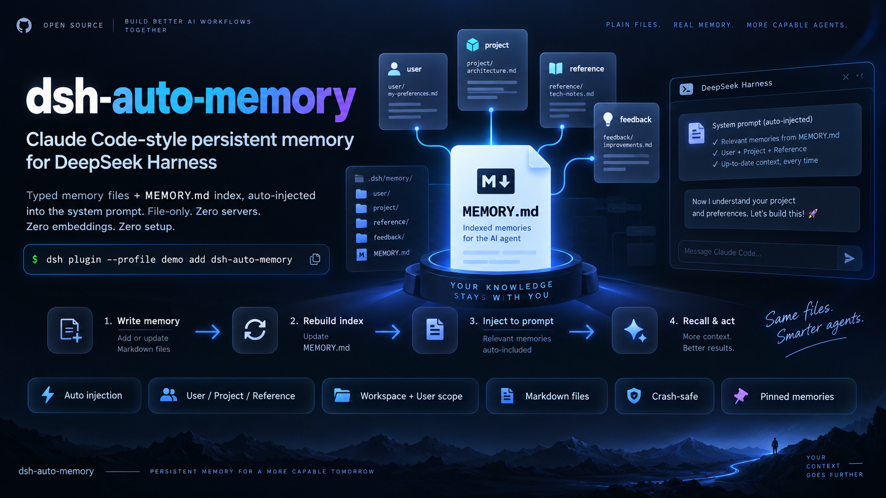

# dsh-auto-memory

[](https://github.com/AskTheWay/dsh-auto-memory/actions/workflows/ci.yml)
[](https://www.npmjs.com/package/dsh-auto-memory)
[](https://www.npmjs.com/package/dsh-auto-memory)
[](LICENSE)
[](package.json)

[English](README.md) | [中文](README.zh.md)

> ### Your dsh agent forgets everything you tell it. Every. Single. Session.
> **Fix it with one command.** Claude Code-style persistent memory for
> [DeepSeek Harness](https://github.com/deepseek-ai/deepseek-harness) — native,
> zero servers, zero embeddings, zero setup.

```sh
dsh plugin --profile demo add dsh-auto-memory
```

Say *"Remember: I'm a Python backend engineer preparing for interviews"* today —
open a brand-new session tomorrow, ask *"what do you know about me?"*, and it
**remembers**.



---

## Highlights

**0.7 — update-replace semantics**: consolidation updates facts in place
instead of piling up near-duplicates, with a matching core shared between
product and eval harness. Verified against the official desktop client
(0.2.0-rc.2). Full history: [CHANGELOG.md](CHANGELOG.md) ·
[Releases](https://github.com/AskTheWay/dsh-auto-memory/releases)

## Claude Code has this. dsh didn't. Now it does.

DeepSeek Harness is the hottest open agent harness on GitHub right now —
models, tools, sandboxes, everything is a plugin. But it ships with **no memory
subsystem at all**. The official answer is three *default-off* MCP configs to
third-party servers, which the official docs themselves qualify: not
auto-injected, no forgetting policy, substring-only search. Your agent has
amnesia by design.

`dsh-auto-memory` closes that gap natively:

| | MCP bridge approach | **dsh-auto-memory** |
|---|---|---|
| Memories injected into **every** system prompt, automatically | ✗ | ✓ (zero tokens when empty) |
| Typed memories: user / feedback / project / reference | ✗ | ✓ |
| Workspace + user scope layers — no cross-project leakage | ✗ | ✓ |
| Crash & concurrency safety (cross-process locks, orphan recovery) | — | ✓ |
| External services / databases / embeddings required | ✓✓✓ | **none — just plain Markdown files** |

Memories are ordinary files under `$DSH_HOME/memory/` — hand-editable,
grep-able, git-friendly, yours.

## One minute to feel it

```sh
node scripts/demo.mjs   # no API key, no browser: watch write → index → inject → recall → forget
```

Or for real, in a chat: tell your agent things worth remembering. The model
calls `memory_write` / `memory_read` / `memory_list` / `memory_delete`,
following Claude Code's write discipline: **dedupe-and-update over piling up**,
absolute dates only, `[[name]]` cross-links, `feedback` memories carry
**Why:** / **How to apply:** lines.

## Import from Claude Code — and take it back

The panel's **📥 Import from Claude Code** button scans
`~/.claude/projects/*/memory` read-only and lists every memory grouped by source
project. Tick what you want and apply: fields map one-to-one (same four types,
H1 → title, ISO `modified` → epoch), same-name memories are skipped, never
overwritten.

Imported files carry an `origin` block (`kind` / `slug` / `file` / `imported` /
`hash`) in their frontmatter, so the checkbox becomes reversible: uncheck an
already-imported memory and apply, and it is deleted from this plugin — the
Claude Code source stays untouched and can be re-imported any time. If the
memory was edited after import, the content fingerprint no longer matches; the
entry is marked **modified** and kept, never silently discarded. Memories
imported by earlier versions (no `origin` block) are recognised by exact content
equality and marked **legacy import**, so they can be revoked the same way.

## What the model actually sees

Every request, one system-prompt section (order 4000) carries the index —
re-evaluated per step, byte-budgeted, and **gone entirely when the store is
empty**:

```
# Persistent memory index
## Project memories
- [压测过 PostgreSQL](id-generator-benchmark.md) — psycopg2 连接池有踩坑经验 (2026-09)
- [用户是 Python 后端工程师](user-prefers-python.md) — 正在准备面试; 偏好中文交流
```

Chinese titles, YAML frontmatter, one file per memory — exactly the Claude
Code `MEMORY.md` model, rebuilt natively on dsh's prompt-assembly pipeline.

## Hardened before first release

This plugin survived a **12-agent adversarial code review** (680k tokens of
source-level scrutiny) before v0.1.0. Five production-grade traps were caught
and fixed — with regression tests — including two that would have been
field incidents:

- **The NTFS silent destroyer**: a memory named `memory` collides with
  `MEMORY.md` on case-insensitive filesystems — the write *succeeds* while
  destroying the record. Blocked by a reserved-name guard.
- **The poisoned-prompt bomb**: three literal `{{{ }}}` braces in any memory
  could crash *every* model request in the workspace — with no way for the
  model to self-recover. Neutralized by a converging sanitizer.

Plus: orphaned-lock self-healing (Ctrl+C can't brick your memory store),
symlink-read protection, malformed-file tolerance, stable index ordering to
protect KV-prefix caches, and a strict no-custom-session-events policy (they
make dsh sessions refuse to resume).

## Measured, not just claimed

A deterministic evaluation layer ([evals/](evals/README.md)) runs in CI —
no LLM, fully reproducible:

- **Injection cost is a flat line** — measured on the real render path
  (typical ~40-char descriptions, default 4 KB budget):

  | memories | 0 | 10 | 20 | 50 | 100 | 200 |
  |---|---|---|---|---|---|---|
  | injected section | **0 B** | 2.3 KB (~564 tok) | 3.2 KB (~801 tok) | 4.0 KB (~1008 tok) | 4.0 KB | 4.0 KB |

  The byte budget is a hard ceiling — from 50 memories on, the section is
  pinned at the cap no matter how many exist (oldest/lowest-ranked rows
  truncate with a marker). An empty store injects **0 bytes**: the whole
  section disappears.
- **Compaction-proof by construction**: the index rides in a *dynamic*
  system-prompt section re-evaluated on every step assembly — context
  compaction only compresses conversation history, so memories survive every
  compaction without re-injection tricks. Approaches that store memories as
  session-log messages lose theirs on the first compaction pass.
- **Eviction never misfires**: four-class mixed scenario — only
  stale-zero-read memories get hidden; zero files lost; one read revives.
- **Known limitation, pinned as baseline**: budget truncation is currently
  positional (index order), not relevance-ranked — probe retention under
  half-budget pressure drops to ~38%→10% as N grows. **Pinning fixes it for
  what matters**: pinned probes retain **≥80%** at the same budget (0.3.0);
  full relevance ranking remains on the roadmap.

This evaluation layer already caught a real bug: the byte budget used to
exclude the policy text, overshooting by ~800 bytes (fixed, regression-tested).

**Verified platform matrix** (manually tested, not just declared):

| | CLI | Desktop | Web profile |
|---|---|---|---|
| dsh version | 0.1.5-rc.2 | 0.2.0-rc.2 | 0.2.1-rc.2 |
| status | ✓ tools/prompt/consolidation | ✓ panel + import + audit | ✓ panel + import |

**150 tests + three eval layers (L0 deterministic / L1 recall / L3 consolidation). 0 runtime deps beyond `yaml`, ~35 kB installed.**

## Install

```sh
dsh plugin --profile demo add dsh-auto-memory   # from npm (prebuilt)
dsh --profile demo                               # restart the profile
```

From source: `npm install && npm run build && dsh plugin --profile demo add /abs/path`.
Requires `@deepseek-ai/dsh >= 0.1.5-rc.2` (Node `^22.19 || >=24`). Works with
the official desktop client — verified on 0.2.0-rc.2.

## Configuration

Override in your profile's `cordis.patch.yml` (config replaces wholesale):

```yaml
- id: auto-memory
  config:
    maxBytes: 4096          # injection budget (index + guidance + wrapper)
    memoryDir: D:/memories  # default: $DSH_HOME/memory
    enableUserScope: true   # false: user layer off on every path
    autoSummarize: false         # true: on root-session end, a background LLM files durable new facts
    autoSummarizeMaxMemories: 5  # cap per consolidation
    autoSummarizeMaxTokens: 2048 # consolidation output cap
    staleAfterDays: 0            # >0: soft-hide zero-read memories older than N days (files kept)
```

## How it works (60 seconds)

- **Write**: tool `execute` → name normalized to `[a-z0-9-]` (reserved names
  rejected) → cross-process file lock (official `dsh-atomic-write`) → atomic
  write → full index rebuild inside the lock.
- **Inject**: one dynamic section re-evaluated on every step assembly; reads
  the index synchronously, enforces the byte budget, neutralizes `{{`.
  Tool writes take effect on the **very next request** — no restart, ever.
- **Audit**: no custom session events (third-party types make dsh refuse to
  resume); everything flows through standard `tool/call` / `tool/result`.

Deep dives: [design decisions](docs/design.md) ·
[postmortem: shipping a PR to awesome-dsh-plugin](docs/postmortem-pr-5696.md)

## Roadmap

- [x] P0 — typed store, four tools, prompt injection, scoped layers, crash safety
- [x] P1 — auto-consolidation on session end, forgetting & eviction, recall expansion, human-gated bulk delete
- [x] P2 — Web UI memory panel, token-cost / recall-quality benchmarks
- [x] P3 — update-replace semantics, matching core shared with the eval harness
- [ ] Injection audit log ([#11](https://github.com/AskTheWay/dsh-auto-memory/issues/11)), L2 end-to-end eval

## Changelog

Per-version notes: [CHANGELOG.md](CHANGELOG.md) ·
[GitHub Releases](https://github.com/AskTheWay/dsh-auto-memory/releases)

## License

MIT
