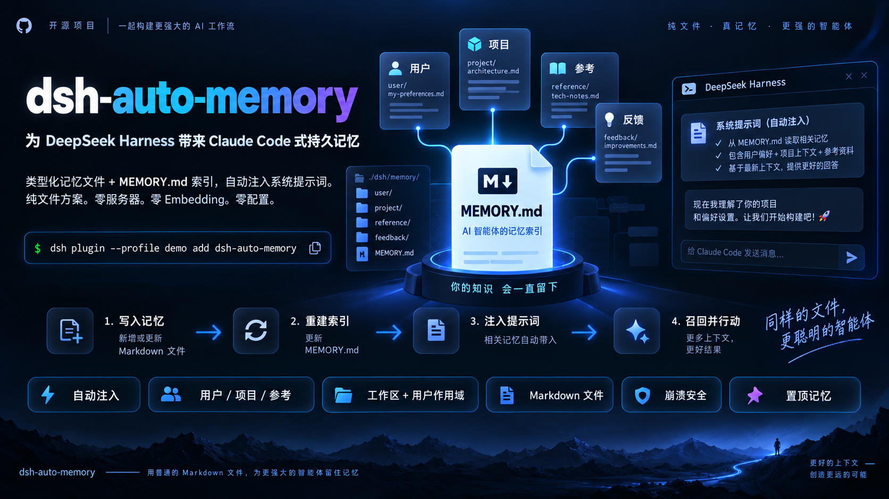

# dsh-auto-memory

[](https://github.com/AskTheWay/dsh-auto-memory/actions/workflows/ci.yml)
[](https://www.npmjs.com/package/dsh-auto-memory)
[](https://www.npmjs.com/package/dsh-auto-memory)
[](LICENSE)
[](package.json)

[English](README.md) | [中文](README.zh.md)

> ### 你的 dsh 智能体把你说过的每件事都忘掉。每一次。每一个会话。
> **一条命令修复。** 把 Claude Code 式持久记忆带给
> [DeepSeek Harness](https://github.com/deepseek-ai/deepseek-harness)——原生实现,
> 零服务器、零 embedding、零配置。

```sh
dsh plugin --profile demo add dsh-auto-memory
```

今天对它说 *"记住:我是准备面试的 Python 后端工程师"*——
明天开一个全新会话,问 *"你对我有什么了解?"*,它**记得**。



---

## 亮点

**0.7——更新替换语义**:固化命中同一事实即原地更新,不再堆积近似重复;
匹配核心由产品与评测共用。已实测官方桌面端(0.2.0-rc.2)。
完整历史:[CHANGELOG.md](CHANGELOG.md) ·
[Releases](https://github.com/AskTheWay/dsh-auto-memory/releases)

## Claude Code 有的东西,dsh 一直没有。现在有了。

DeepSeek Harness 是当下 GitHub 最火的开源智能体框架——模型、工具、沙箱,万物皆插件。
但它**根本没有记忆子系统**。官方的答案是三份*默认关闭*的 MCP 外挂配置,而且官方文档
自己承认局限:不自动注入、无遗忘策略、只做子串搜索。你的智能体是**设计层面的失忆症**。

`dsh-auto-memory` 用原生实现补上这个缺口:

| | MCP 外挂方案 | **dsh-auto-memory** |
|---|---|---|
| 记忆自动注入**每一次**系统提示词 | ✗ | ✓(无记忆时零 token 占用) |
| 类型化记忆:user / feedback / project / reference | ✗ | ✓ |
| 工作区 + 用户双层作用域——跨项目不串扰 | ✗ | ✓ |
| 崩溃与并发安全(跨进程锁、孤儿锁自愈) | — | ✓ |
| 需要外部服务 / 数据库 / embedding | ✓✓✓ | **全都不用——纯 Markdown 文件** |

记忆是 `$DSH_HOME/memory/` 下的普通文件——可手改、可 grep、对 git 友好,完全属于你。

### 可信,不只是持久(1.0.0)

模型固化出的记忆可能"自信地错"——而错记忆每个会话都会被重新注入。所以记忆带**可信状态**:固化产物出生即 `candidate`(附转写逐字证据摘录,伪造引用会被对照转写拦下),`verified` 只能由**你**在面板授予,`disputed` / `superseded` 永不注入。所有写入路径在存储单点过注入模式守卫;内容变化自动降级信任并使旧证据失效。`🩺` 体检面板汇总待验证/僵尸/矛盾嫌疑供复核。同样的扁平文件、同样的零服务——现在连"要不要信它"都有审计轨迹。

## 一分钟感受它

```sh
node scripts/demo.mjs   # 不要 API key、不开浏览器:看 写入 → 索引 → 注入 → 召回 → 遗忘
```

或者在真实对话里:告诉智能体值得记住的事。模型调用
`memory_write` / `memory_read` / `memory_list` / `memory_delete`,
遵循 Claude Code 的写入纪律:**查重更新而非堆积**、只用绝对日期、
`[[name]]` 交叉链接、`feedback` 记忆附 **Why:** / **How to apply:** 行。

## 从 Claude Code 导入,也能撤销

面板里的 **📥 从 Claude Code 导入** 按钮只读扫描 `~/.claude/projects/*/memory`,
按源项目分组列出每条记忆。勾选后应用:字段一一映射(同款四类型、H1 → 标题、
ISO `modified` → 时间戳),同名记忆跳过、绝不覆盖。

导入的记忆在 frontmatter 里带一个 `origin` 块(`kind` / `slug` / `file` /
`imported` / `hash`),所以勾选框是可逆的:取消勾选一条已导入的记忆并应用,
它就从本插件删除——Claude Code 里的源记忆原样保留,随时可以再导。导入后被
编辑过的记忆,内容指纹对不上,会标成**已修改**并保留,绝不会被静默丢掉。
旧版本(0.8.0/0.9.x)导入、没有 `origin` 标记的记忆按内容完全一致识别为
**旧版导入**,同样可以取消勾选撤销。

## 模型实际看到什么

每个请求,一个系统提示词段(order 4000)携带索引——每步重新求值、字节预算控制、
存储为空时**整段消失**:

```
# Persistent memory index
## Project memories
- [压测过 PostgreSQL](id-generator-benchmark.md) — psycopg2 连接池有踩坑经验 (2026-09)
- [用户是 Python 后端工程师](user-prefers-python.md) — 正在准备面试; 偏好中文交流
```

中文标题、YAML frontmatter、一条记忆一个文件——完整的 Claude Code `MEMORY.md`
模型,在 dsh 的提示词组装管线上原生重建。

## 首发之前就被锤炼过

这个插件在 v0.1.0 发布前经受了一次 **12 个智能体的对抗性代码审查**
(68 万 token 的源码级拷问)。五个生产级陷阱被抓出并修复——全部带回归测试——
其中两个若上线就是事故:

- **NTFS 静默毁数据**:名为 `memory` 的记忆会在大小写不敏感文件系统上撞上
  `MEMORY.md`——写入*报告成功*,实际销毁记录。保留字守卫拦截。
- **毒提示炸弹**:任何记忆里三个字面 `{{{ }}}` 花括号,就能炸掉工作区的
  *每一个*模型请求——且模型无法自救。收敛式消毒器中和。

还有:孤儿锁自愈(Ctrl+C 砸不坏你的记忆库)、symlink 读取防护、坏文件容错、
稳定的索引排序(保住 KV 前缀缓存)、严格不写自定义会话事件(那会让 dsh 会话
拒绝 resume)。

## 用数字说话,不止口头宣称

确定性评测层([evals/](evals/README.md))随 CI 运行——无 LLM、结果完全可复现:

- **注入成本是一条平线**——真实渲染路径实测(典型 ~40 字中文摘要,默认 4 KB 预算):

  | 记忆条数 | 0 | 10 | 20 | 50 | 100 | 200 |
  |---|---|---|---|---|---|---|
  | 注入段 | **0 B** | 2.3 KB (~564 tok) | 3.2 KB (~801 tok) | 4.0 KB (~1008 tok) | 4.0 KB | 4.0 KB |

  字节预算是硬顶——50 条之后无论存多少条,注入段钉在上限(排序靠后的行带
  截断标记让位);空库注入 **0 字节**:整段消失。
- **架构级压缩免疫**:索引挂在*动态*系统提示词段上、每步组装重新求值——
  上下文压缩(compaction)只压会话历史,压不到系统提示词段,记忆无需任何
  "重注入补丁"天然穿越每次压缩。把记忆存成会话日志消息的方案在第一次
  压缩就会丢。
- **淘汰零误杀**:四类混合场景——只有"超龄零引用"被隐藏,文件零丢失,
  读一次即复活。
- **已知局限(有意钉板)**:预算截断目前按索引行序(位置式)而非相关性排序——
  半量预算压力下探针保留率随规模降至 ~38%→10%。**置顶可解关键项**:同预算下
  pinned 探针保留 **≥80%**(0.3.0);完整相关性排序仍在路线图。

评测层已抓到过真实 bug:字节预算曾遗漏指导文本、整段超支 ~800 字节
(已修复并带回归)。

**已实测平台矩阵**(手动验证,非纸面声明):

| | CLI | 桌面端 | Web profile |
|---|---|---|---|
| dsh 版本 | 0.1.5-rc.2 | 0.2.0-rc.2 | 0.2.1-rc.2 |
| 状态 | ✓ 工具/注入/固化 | ✓ 面板 + 导入 + 审计 | ✓ 面板 + 导入 |

**182 项测试 + 三层评测(L0 确定性/L1 召回/L3 固化质量)。运行时依赖仅 `yaml`。**

## 安装

```sh
dsh plugin --profile demo add dsh-auto-memory   # npm 直装(预构建)
dsh --profile demo                               # 重启 profile 生效
```

源码安装:`npm install && npm run build && dsh plugin --profile demo add /绝对路径`。
要求 `@deepseek-ai/dsh >= 0.1.5-rc.2`(Node `^22.19 || >=24`)。
兼容官方桌面端——已在 0.2.0-rc.2 实测。

## 配置

在 profile 的 `cordis.patch.yml` 覆盖(config 整表替换):

```yaml
- id: auto-memory
  config:
    maxBytes: 4096          # 注入预算(索引+指导文本+协议壳)
    memoryDir: D:/memories  # 默认: $DSH_HOME/memory
    enableUserScope: true   # false: 用户层在所有路径禁用
    autoSummarize: false         # true: 根会话结束时后台 LLM 提取持久事实写入
    autoSummarizeMaxMemories: 5  # 单次固化上限
    autoSummarizeMaxTokens: 2048 # 固化输出 token 上限
    staleAfterDays: 0            # >0: 软隐藏超 N 天零引用记忆(文件保留)
```

## 工作原理(60 秒)

- **写入**:工具 `execute` → name 归一化为 `[a-z0-9-]`(保留字拒绝)→
  跨进程文件锁(官方 `dsh-atomic-write`)→ 原子写 → 锁内全量重建索引。
- **注入**:单个动态段,每步组装重新求值;同步读索引、执行字节预算、中和 `{{`。
  工具写入在**下一个请求**即生效——永远不需要重启。
- **审计**:不写自定义会话事件(第三方事件类型会让 dsh 拒绝 resume);
  一切走标准 `tool/call` / `tool/result`。

深度内容:[设计决策](docs/design.md) ·
[复盘:向 awesome-dsh-plugin 提 PR](docs/postmortem-pr-5696.md)

## 路线图

- [x] P0——类型化存储、四工具、提示词注入、分层作用域、崩溃安全
- [x] P1——会话结束自动固化、遗忘与淘汰、召回展开、人工审批的批量删除
- [x] P2——Web UI 记忆面板、token 成本/召回质量评测
- [x] P3——更新替换语义、匹配核心与评测共用
- [ ] 注入审计日志([#11](https://github.com/AskTheWay/dsh-auto-memory/issues/11))、L2 端到端评测

## 更新日志

逐版本说明:[CHANGELOG.md](CHANGELOG.md) ·
[GitHub Releases](https://github.com/AskTheWay/dsh-auto-memory/releases)

## 许可

MIT
